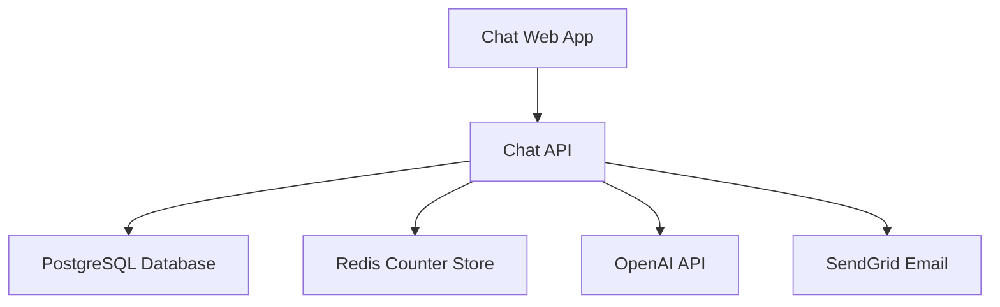
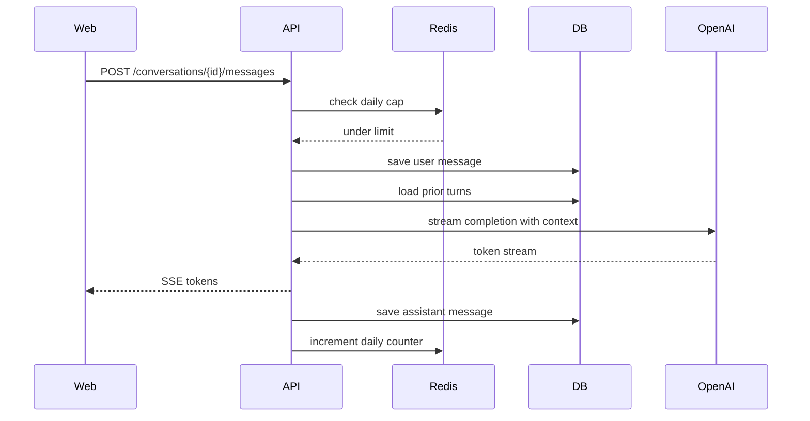
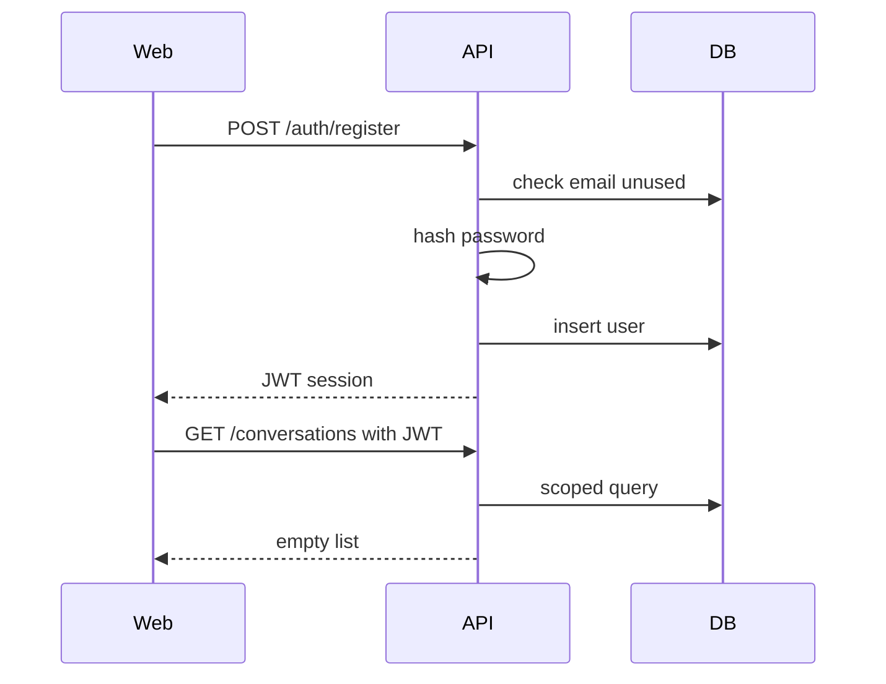
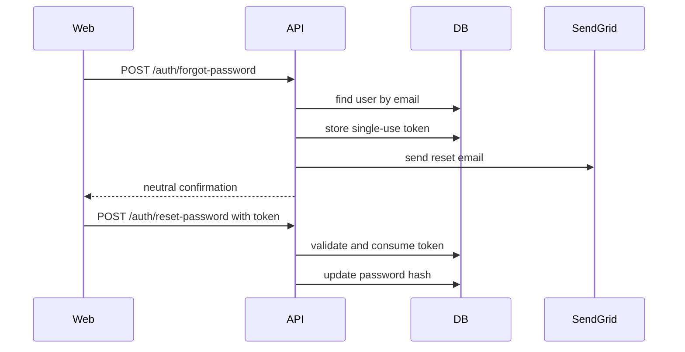
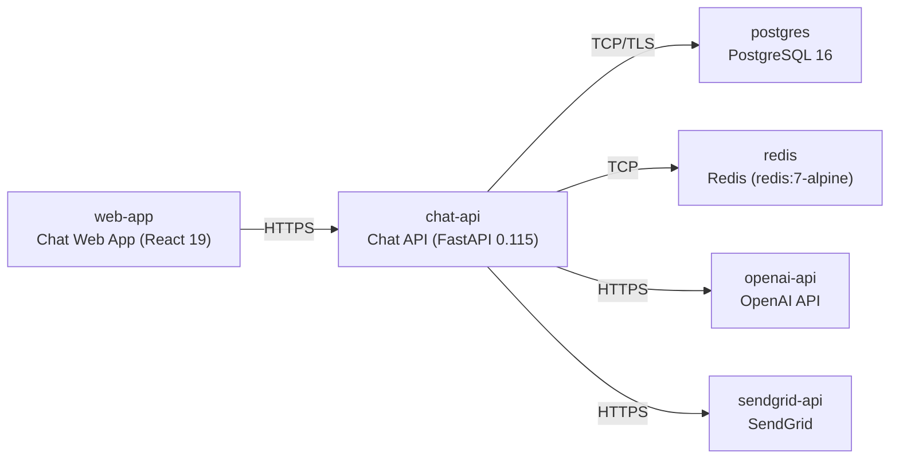

# Architecture

> Maintained by QuorQ AI SDLC. Text between `sdlc:auto` markers is regenerated; anything outside them is yours and is kept.

<!-- sdlc:auto:start narrative -->
## Overview

### ARCH-000 · approved · source: architecture:summary

Approved architecture (v1): React 19 SPA over HTTPS to a FastAPI 0.115 backend, persisting to PostgreSQL 16, streaming OpenAI completions, enforcing a daily cap via Redis, and sending password-reset email via SendGrid, deployed as small containers plus managed Postgres on AWS.

A lightweight, mobile-responsive chat application where anyone can self-register, sign in, and hold several private conversations with an OpenAI-backed general assistant whose answers stream token-by-token. Cloud decision: AWS — one small container each for API, web and Redis plus managed RDS Postgres, chosen for tens-of-users demo scale, cost, and keeping data/secrets/logs in a single account with room to grow. This directly implements the requirements-approved stack (REQ-000) with no substitutions.

**Related:** EPIC-001, EPIC-002, EPIC-003, EPIC-004, EPIC-005

### ARCH-COMP-web · approved · source: architecture:web

Chat Web App (React 19): responsive sign-up/sign-in, sidebar, composer, streamed thread with markdown/code rendering, rename/delete controls.

Technology decision: React 19 — approved stack. Renders the responsive sidebar-plus-thread layout and consumes the SSE/stream response to append tokens into the thread as they arrive. Supports US-001–US-004 (auth UI), US-005–US-008 (streaming thread, formatting), US-010–US-014 (sidebar/new/rename/delete), US-015–US-016 (responsive, English-only).

**Related:** EPIC-001, EPIC-002, EPIC-003, EPIC-004

### ARCH-COMP-api · approved · source: architecture:api

Chat API (FastAPI 0.115): auth, conversation/message CRUD with scoped data access, OpenAI streaming proxy, context assembly/trimming, daily-cap enforcement, password-reset flow.

Technology decision: FastAPI 0.115 — approved stack. Streams OpenAI tokens to the browser natively via StreamingResponse; auth, CRUD, and cap endpoints are implemented as small standard routes. Backs US-001–US-004 (auth/isolation), US-005, US-007, US-009 (streaming, context, cap), US-010–US-014 (conversation CRUD), US-017–US-018 (LLM/prompt config).

**Related:** EPIC-001, EPIC-002, EPIC-003, EPIC-005

### ARCH-COMP-db · approved · source: architecture:db

PostgreSQL 16 database storing users, conversations, messages and password-reset tokens with per-account isolation.

Technology decision: PostgreSQL 16 — approved stack. Users, conversations and messages are plain related records; every query is 'this user's conversations' or 'this conversation's messages in order', which Postgres handles trivially at demo scale while keeping per-account data cleanly separated. Backs US-001–US-004 (account/isolation), US-003 (reset tokens), US-010–US-014 (conversation persistence, history, rename, delete).

**Related:** EPIC-001, EPIC-003

### ARCH-COMP-cache · approved · source: architecture:cache

Redis Counter Store (redis:7-alpine): per-account daily message counters with day-boundary expiry for instant cap enforcement.

Supports US-009 (daily message cap per account) by holding fast, server-side counters so the cap can be checked before any LLM call is made.

**Related:** EPIC-002

### ARCH-COMP-openai · approved · source: architecture:openai

OpenAI API (SaaS): hosted LLM generating every assistant answer, streamed token-by-token.

Backs US-005 (streamed answers), US-007 (context-aware replies), US-017 (operator-configured key/model). Requires OPENAI_API_KEY per requirements.

**Related:** EPIC-002, EPIC-005

### ARCH-COMP-sendgrid · approved · source: architecture:sendgrid

SendGrid Email (SaaS): delivers the single-use password-reset email reliably to external inboxes.

Backs US-003 (reset a forgotten password). Requires SENDGRID_API_KEY per requirements.

**Related:** EPIC-001
<!-- sdlc:auto:end narrative -->

<!-- sdlc:auto:start building-blocks -->
## Building Block View

| ID | Name | Technology | Responsibility | Depends on |
|---|---|---|---|---|
| web | Chat Web App | React 19 | Responsive chat UI: sign-up/sign-in, conversation sidebar, composer, streamed message thread with markdown/code rendering, rename and delete. | api |
| api | Chat API | FastAPI 0.115 | Auth, conversation and message CRUD, scoped data access, OpenAI streaming proxy, context assembly and trimming, daily-cap enforcement, password-reset flow. | db, cache, openai, sendgrid |
| db | PostgreSQL Database | PostgreSQL 16 | Stores users, conversations, messages and password-reset tokens with per-account isolation. | — |
| cache | Redis Counter Store | Redis (redis:7-alpine) | Holds per-account daily message counters with day-boundary expiry for instant cap enforcement. | — |
| openai | OpenAI API | OpenAI (SaaS) | Hosted LLM that generates every assistant answer, streamed token-by-token. | — |
| sendgrid | SendGrid Email | SendGrid (SaaS) | Delivers the single-use password-reset email reliably to external inboxes. | — |

<!-- sdlc:auto:end building-blocks -->

<!-- sdlc:auto:start runtime -->
## Runtime View

### Streamed chat turn with memory and cap

User sends a message in an open conversation; the server checks the daily cap in Redis, persists the user message, assembles prior turns plus the system prompt (trimmed to the context limit), streams the OpenAI completion back over SSE while the UI renders tokens, then persists the full assistant reply and increments the counter.

- **Components:** web, api, cache, db, openai
- **Modules:** chat_router, message_service, cap_service, openai_client, context_builder
- **Key functions:** post_message(conversation_id, text, user), check_and_reserve_cap(user_id), build_context(conversation_id, limit), stream_completion(messages), persist_assistant_message(conversation_id, content)

### Sign-up and session

Visitor registers with email and password; server validates, stores a salted bcrypt hash, creates the user and issues a JWT session, landing the user on an empty chat screen.

- **Components:** web, api, db
- **Modules:** auth_router, auth_service, password_hasher, jwt_service
- **Key functions:** register(email, password), hash_password(password), issue_token(user_id), authenticate(email, password)

### Password reset

User requests a reset; server always returns a neutral confirmation, and only if the account exists issues a single-use, time-limited token and emails a link via SendGrid; opening a valid link lets the user set a new password.

- **Components:** web, api, db, sendgrid
- **Modules:** auth_router, reset_service, email_client, jwt_service
- **Key functions:** request_reset(email), create_reset_token(user_id), send_reset_email(email, link), complete_reset(token, new_password)

<!-- sdlc:auto:end runtime -->

<!-- sdlc:auto:start deployment-view -->
## Deployment View

| Name | Service | Runtime | Scaling | Environment |
|---|---|---|---|---|
| web-app | Chat Web App (React 19) | Container on AWS ECS Fargate | single task (demo) | dev |
| chat-api | Chat API (FastAPI 0.115) | Container on AWS ECS Fargate | single task (demo) | dev |
| postgres | PostgreSQL 16 | Amazon RDS for PostgreSQL (small managed instance) | single instance | dev |
| redis | Redis (redis:7-alpine) | Container on AWS ECS Fargate | single task (demo) | dev |
| openai-api | OpenAI API | External SaaS | managed by provider | dev |
| sendgrid-api | SendGrid | External SaaS | managed by provider | dev |

| Source | Target | Protocol |
|---|---|---|
| web-app | chat-api | HTTPS |
| chat-api | postgres | TCP/TLS |
| chat-api | redis | TCP |
| chat-api | openai-api | HTTPS |
| chat-api | sendgrid-api | HTTPS |

<!-- sdlc:auto:end deployment-view -->

<!-- sdlc:auto:start decisions -->
## Architecture Decisions

| Layer | Choice | ADR |
|---|---|---|
| Frontend | React 19 | [ADR-0001](adr/frontend.md) |
| Backend | FastAPI 0.115 | [ADR-0002](adr/backend.md) |
| Database | PostgreSQL 16 | [ADR-0003](adr/database.md) |
| Cloud | AWS | [ADR-0004](adr/cloud.md) |
<!-- sdlc:auto:end decisions -->

<!-- sdlc:auto:start links -->
## Related Documents

- [Data Model](data-model.md)
- [API Specification](api/openapi.yaml)
- [Architecture Decision Records](adr/README.md)
<!-- sdlc:auto:end links -->
