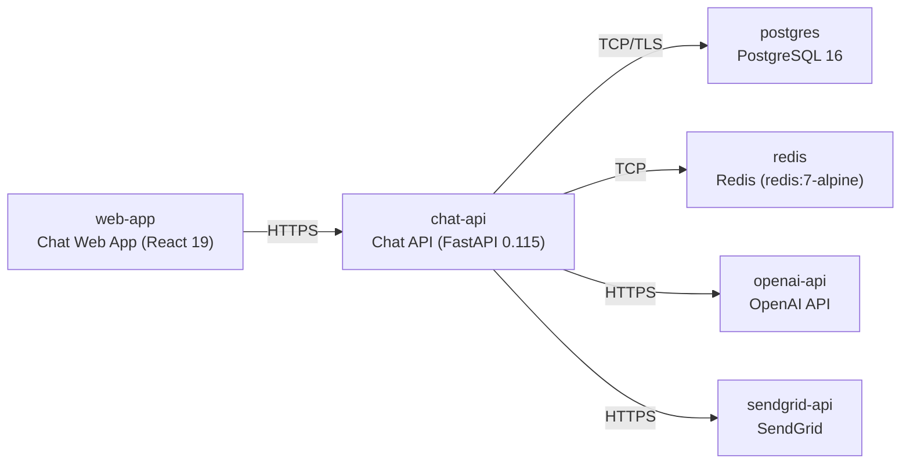

# Deployment Guide

> Maintained by QuorQ AI SDLC. Text between `sdlc:auto` markers is regenerated; anything outside them is yours and is kept.

<!-- sdlc:auto:start how-it-deploys -->
Pushes to `main` run `.github/workflows/deploy.yml`, which builds the API image (if there is a backend) and deploys the SPA to AWS Amplify. Commits touching only `docs/sdlc/**` don't deploy. Deployments can also be started from the platform's Deployment tab.
<!-- sdlc:auto:end how-it-deploys -->

<!-- sdlc:auto:start environments -->
| Name | Service | Runtime | Scaling | Environment |
|---|---|---|---|---|
| web-app | Chat Web App (React 19) | Container on AWS ECS Fargate | single task (demo) | dev |
| chat-api | Chat API (FastAPI 0.115) | Container on AWS ECS Fargate | single task (demo) | dev |
| postgres | PostgreSQL 16 | Amazon RDS for PostgreSQL (small managed instance) | single instance | dev |
| redis | Redis (redis:7-alpine) | Container on AWS ECS Fargate | single task (demo) | dev |
| openai-api | OpenAI API | External SaaS | managed by provider | dev |
| sendgrid-api | SendGrid | External SaaS | managed by provider | dev |
<!-- sdlc:auto:end environments -->

<!-- sdlc:auto:start live -->
_Not deployed yet._
<!-- sdlc:auto:end live -->

<!-- sdlc:auto:start topology -->

<!-- sdlc:auto:end topology -->
